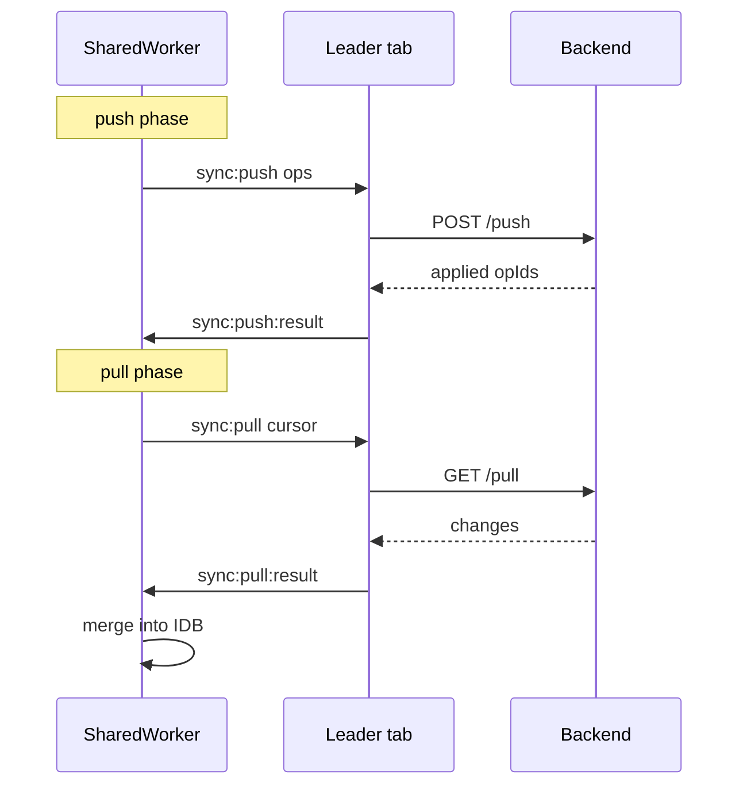

# Remote sync

## Overview

worker-sync-db uses an **offline-first** model:

1. `put` / `delete` write to IndexedDB immediately.
2. When `remote` is configured, each mutation is appended to `sync_queue` as a `PendingOp` (local-only DBs do not enqueue).
3. After writes, sync is **debounced** (~300ms) via `scheduleSync`. Explicit `syncNow()` runs immediately.
4. On sync failure, the worker schedules an **exponential backoff** retry (with jitter), exposed as `SyncStatus.nextSyncAt`. Auto-sync pauses while `online: false` and resumes on `online`. Call `pauseSync()` / `resumeSync()` to suspend or resume automatic sync without going offline (`SyncStatus.paused`).
5. Remote changes merge with **LWW** (last write wins) using `_updatedAt` and `_version`, then **broadcast** to subscribed tabs as `change` events.

## Delegate vs fetch



### Delegate mode (`RemoteSyncAdapter`)

Use when you need custom auth, retries, or non-REST protocols.

```typescript
const db = await createDatabase({
  schema,
  dbName: 'my-app',
  sharedWorker: new URL('worker-sync-db/shared-worker', import.meta.url),
  remote: {
    async pull(cursor) {
      const res = await fetch(`/api/sync/pull?cursor=${cursor ?? ''}`);
      return res.json();
    },
    async push(ops) {
      const res = await fetch('/api/sync/push', {
        method: 'POST',
        headers: { 'Content-Type': 'application/json' },
        body: JSON.stringify({ ops }),
      });
      return res.json();
    },
  },
  onConflict: (conflict) => {
    if (conflict.kind === 'push') {
      console.warn('Push conflict', conflict.opId, conflict.reason);
    } else {
      // LWW inspect — default strategy already applied; re-`put` to override.
      console.warn('LWW', conflict.outcome, conflict.collection, conflict.id);
    }
  },
});
```

Functions run on the **leader tab** (first connected tab with `syncCapable: true`). Other tabs only receive `SyncStatus` broadcasts.

### Fetch mode (`FetchSyncConfig`)

Use for simple REST endpoints without custom client logic.

```typescript
remote: {
  pullUrl: '/api/sync/pull',
  pushUrl: '/api/sync/push',
  // Auth / custom headers are forwarded on push and pull:
  headers: {
    Authorization: `Bearer ${token}`,
    'X-Tenant-Id': tenantId,
  },
},
onConflict: (conflict) => {
  // Inspect only — v1 is last-write-wins; no CRDT merge hook.
  if (conflict.kind === 'push') {
    console.warn('Push conflict', conflict.opId, conflict.reason);
  } else if (conflict.outcome === 'remote-applied') {
    // Optional “resolve”: write preferred fields again after inspect.
    console.info('Remote overwrote local', conflict.id, conflict.local, conflict.remote);
  }
},
```

HTTP runs inside the SharedWorker via `fetch()`. Push and LWW inspect conflicts are broadcast as `conflict` events so `onConflict` runs in the app tab (same option as delegate mode).

## Backend contract

### Push request body

```json
{
  "ops": [
    {
      "opId": "uuid",
      "collection": "todos",
      "kind": "put",
      "doc": {
        "id": "1",
        "title": "Milk",
        "status": "open",
        "_version": 2,
        "_updatedAt": 1717000000000
      }
    }
  ]
}
```

### Push response

```json
{
  "applied": ["opId-1", "opId-2"],
  "conflicts": [{ "opId": "opId-3", "reason": "version mismatch" }]
}
```

Applied `opId`s are removed from the local queue. Optional push `conflicts` trigger `onConflict` with `{ kind: 'push', opId, reason }`.

On pull, when a remote change competes with an existing local doc, `onConflict` also receives `{ kind: 'lww', outcome: 'local-wins' | 'remote-applied', collection, id, local, remote, reason }` **after** LWW has already decided. This is inspect-only (not a CRDT resolver); re-`put` if the app wants a different final value.

### Pull response

```json
{
  "changes": [
    {
      "collection": "todos",
      "kind": "put",
      "doc": {
        "id": "1",
        "title": "Milk",
        "status": "done",
        "_version": 3,
        "_updatedAt": 1717000001000
      }
    }
  ],
  "nextCursor": "cursor-token-or-null"
}
```

`nextCursor` is stored in IndexedDB meta and sent on the next pull.

## Mock adapter (example app)

The React example uses an in-memory adapter with artificial delay — see [examples/vite-react-todos/src/sync/mockAdapter.ts](../examples/vite-react-todos/src/sync/mockAdapter.ts).

## SyncStatus

Subscribe for UI indicators (queue depth, next attempt, pause):

```typescript
db.onSyncStatusChange((status) => {
  console.log({
    queueDepth: status.pending,
    nextSyncAt: status.nextSyncAt,
    paused: status.paused,
    online: status.online,
    lastError: status.lastError,
  });
});

await db.pauseSync();   // stop debounce / backoff
await db.resumeSync();  // schedule soon when online
await db.syncNow();     // still works while paused
```

| Field | Meaning |
|-------|---------|
| `pending` | Ops waiting in sync queue (queue depth) |
| `lastSyncAt` | Timestamp of last successful sync |
| `lastError` | Last error message or null |
| `nextSyncAt` | Epoch ms when the next auto-sync (debounce/backoff) will run, or `null` |
| `online` | `navigator.onLine` in worker |
| `paused` | User paused automatic sync via `pauseSync()` |
